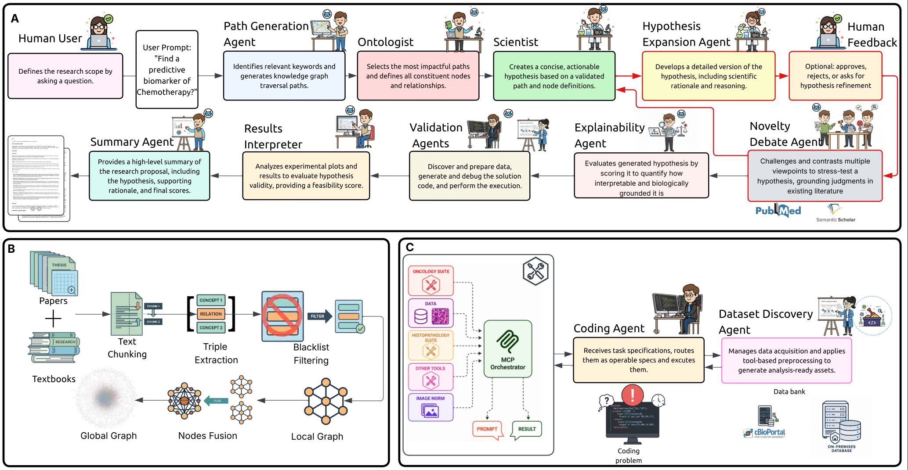

# Healthcare Hypothesis Generation Pipeline

## Examples

Agent factory functions available (from `HypothesisGeneration.agents`):

- create_coding_tasks_agent
- create_hypothesis_expansion_agent
- create_novelty_critic_agent
- create_multi_critic_agent
- create_ontologist
- create_explainability_agent
- create_multi_critic_coordinator
- create_path_generation_agent
- create_scientist
- create_summary_agent

Example is available in `notebooks/initial_global_graph.ipynb`.

### Typical pipeline flow
1. Input preparation: load context (graph fragments, embeddings, tokenizer) from `inputs/`.
2. Path generation + Ontologist: generate paths over the knowledge graph and define terms and relationships.
2. Scientist agent: proposes 1 candidate hypothesis.
3. Expansion: The candidate hypothesis is expanded into testable statements.
4. Novelty critique: Novelty scoring based on current literature.
5. (Optional) User input: Incorporate feedback or additional constraints from the user. `"Approved"` is required to proceed.
6. Explainability agent: Evaluates biological and clinical interpretability of biomarkers.
7. Coding task generation: produce an structured coding task for evaluation/analysis.
8. Summarization: produce a summary and recommended next steps.


## Installation

### Recommended:
Create a virtualenv and install the two packages in editable mode so changes are picked up during development.

```bash
python -m venv .venv
source .venv/bin/activate
cd Hypothesis_generation_pipeline
pip install -e GraphReasoning
pip install -e HypothesisGeneration
```

### Set up environment variables
- OPENAI_API_KEY
- SEMANTIC_SCHOLAR_API_KEY


##  Pipeline structure




## The HypothesisGeneration module

### Purpose
- Orchestrates a set of specialized agents to generate, expand, and critique candidate scientific hypotheses. The module is designed to be modular so new agents and reasoning steps can be added with minimal changes.

### Main components
- hypothesis_generation_pipeline.py — pipeline runner and orchestration. Responsible for wiring agents together, sequencing steps (generate → expand → critique → summarize), and collecting structured outputs.

- Agents: — a family of agent classes, each encapsulating a role and prompt logic:
    - path_generation_agent.py — Agent that finds a path between several nodes in the knowledge graph.
    - ontologist.py — Agent that defines the terms in the path and finds logical connections between them.
    - scientist.py — Agent that proposes initial hypotheses based on the generated path and ontology expansions.
    - hypothesis_expansion_agent.py — Agent that expands the existing hypotheses into a more concrete, testable hypothesis.
    - novelty_critic_agent.py — Agent that evaluates novelty and flags hypotheses that are already obvious or well-supported by the literature. Gives a novelty score.
    - multi_critic_agent.py — Agent that uses Prover-Verifier-Judge game-theoretic debate framework for evaluation.
    - explainability_agent.py — Agent that that calculates and evaluates an Explainability Index (EI) score for biomarkers based on five structured components.
    - coding_tasks_agent.py — Agent that translates a chosen hypothesis into a coding/analysis task specification. Used for validation and analysis.
    - summary_agent.py — Agent that compresses multi-agent outputs into a human-readable summary and recommended next steps.

- utils.py/ report_parser.py — helper functions.
- modifiedAutogen/ — lightweight adaptations of the Autogen console and OpenAI agent to enable reasoning traces and save transcripts.

The current configuration uses a multi-path mode. To switch to single-path mode, comment out lines 209-401 and 410-417, and uncomment lines 419-426 in hypothesis_generation_pipeline.py located in the Hypothesis Generation folder.

## High-level file structure

Top-level layout (relevant folders):

```
Hypothesis_generation_pipeline/
├─ GraphReasoning/          # Graph utilities
├─ HypothesisGeneration/    # Pipeline runner, agents, parsers, utils
│  ├─ HypothesisGeneration/ #Pipeline code
│  │  ├─ hypothesis_generation_pipeline.py
│  │  ├─ report_parser.py
│  │  ├─ utils.py
│  │  └─ agents/            # Agent implementations (scientist, critic, etc.)
│  │     ├─ scientist.py
│  │     ├─ novelty_critic_agent.py
│  │     ├─ multi_critic_agent.py
│  │     ├─ multi_critic_coordinator.py
│  │     ├─ path_generation_agent.py
│  │     ├─ ontologist.py
│  │     ├─ summary_agent.py
│  │     ├─ hypothesis_expansion_agent.py
│  │     ├─ explainability_agent.py
│  │     ├─ coding_tasks_agent.py
│  │     └─ dummy_agent.py
│  └─ modifiedAutogen/      # Modified autogen tooling (console, reasoning agent)
├─ img/
├─ inputs/                  # Inputs (graphs, embeddings)
├─ outputs/                 # Summary
└─ playground/              # demos and quick tests
```


## References

```bibtex
@article{ghafarollahi2024sciagents,
    title={SciAgents: Automating Scientific Discovery Through Bioinspired Multi-Agent Intelligent Graph Reasoning},
    author={Ghafarollahi, Alireza and Buehler, Markus J},
    journal={Advanced Materials},
    pages={2413523},
    year={2024},
    publisher={Wiley Online Library}
}

@article{buehler2024graphreasoning,
    author={Markus J. Buehler},
    title={Accelerating Scientific Discovery with Generative Knowledge Extraction, Graph-Based Representation, and Multimodal Intelligent Graph Reasoning},
    journal={Machine Learning: Science and Technology},
    year={2024},
    url={http://iopscience.iop.org/article/10.1088/2632-2153/ad7228},
}
```

## Citation

If you use SAGE or the Healthcare Hypothesis Generation Pipeline
in your research, please cite our paper:

**SAGE: Evidence-First Biomarker Discovery through Multi-Agent Reasoning**  
*Advances in Neural Information Processing Systems (NeurIPS 2026).*

```bibtex
@inproceedings{nasser2026sage,
  title     = {{SAGE}: Evidence-First Biomarker Discovery
               through Multi-Agent Reasoning},
  author    = {Nasser, Sahar Almahfouz and others},
  booktitle = {Advances in Neural Information Processing Systems},
  year      = {2026}
}
```

Please also cite the original SciAgents and GraphReasoning
publications, listed in the References section, when using
or building upon those components.

## License

The SAGE Healthcare Hypothesis Generation Pipeline is
licensed under the **Apache License, Version 2.0**.

This license permits academic and commercial use,
modification, and redistribution, subject to the
license terms and attribution requirements.

See the [LICENSE](LICENSE) file for the complete terms.

Third-party software and components included in this
repository remain subject to their respective licenses.
